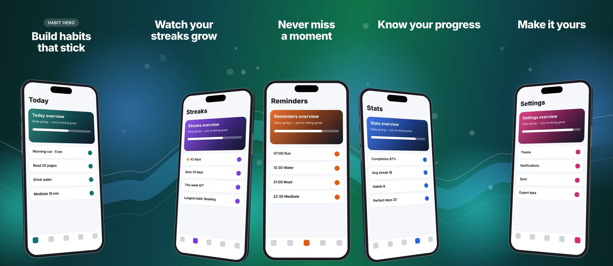
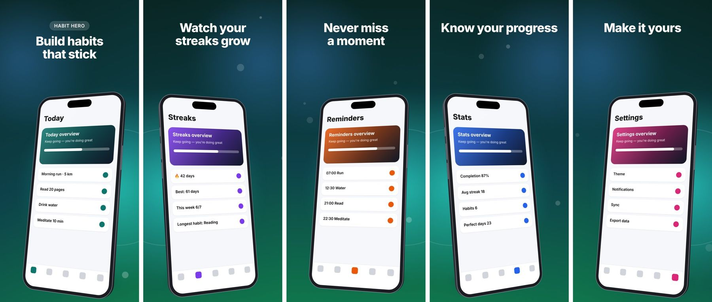

# App Store Screenshot Studio

App Store screenshot generator for iOS apps: send a public GitHub repository of a mobile app and 5 app screenshots,
get back **panoramic** and **3D** screenshot sets with headlines written from the repository, in App Store Connect's
sizes. A paid service on **Stellar mainnet**: AI agents and apps pay per call in USDC through x402, under
[Provider Standard v1](https://github.com/AlgoriaLabs/stellar-agent-services/blob/main/docs/provider-standard.md), and
find it through [Stellar Agent Search](https://github.com/berkingurcan/stellar-agent-search). Made with
`npm create stellar-service` (TypeScript kind).

| Set | What it looks like |
| --- | --- |
| `panoramic` | One continuous background, ribbon and glow across all 5 images, so the row reads as one wide picture on the App Store. Devices fan out in 3D; two cross into the next image. |
| `3d` | 5 standalone images, each with a device extruded in CSS 3D and tilted a different way. |




Sizes (portrait, PNG or JPEG, no alpha channel, as App Store Connect requires):

| id | Pixels | Note |
| --- | --- | --- |
| `iphone-6.9` | 1320 × 2868 | Default. The largest; App Store Connect scales it down. |
| `iphone-6.3` | 1206 × 2622 | Default. Required for every iPhone app. |
| `iphone-6.5` | 1284 × 2778 | |
| `iphone-5.5` | 1242 × 2208 | |
| `ipad-13` | 2064 × 2752 | Required if the app runs on iPad. Send iPad screenshots for it. |

## How it works

1. **Repository** (`src/lib/github.ts`): name, description, topics, README, platform (Flutter, Expo / React Native,
   native) and brand colors from `app.json`, `pubspec.yaml`, `Info.plist`, `colors.xml` and theme files.
2. **Screenshots** (`src/lib/images.ts`): HTTPS links (SSRF-guarded), paths inside the repository, or base64; decoded
   and checked by sharp.
3. **Copy** (`src/lib/copywriter.ts`): a cheap model writes a headline and subheadline per screen, seeing small
   thumbnails of each. Without a model key, headlines come from the README's feature list, at no cost.
4. **Render** (`src/render/`): headless Chromium draws each set from HTML/CSS, one screenshot-sized viewport at a
   time; sharp flattens the PNGs to RGB.
5. **Result**: links to every image and a zip (`/files/<random>/screenshots.zip`), kept 7 days, as long as the job.

The service charges **on success**: a buyer whose links don't load, or whose job fails for any reason, pays nothing.

## Costs

| Piece | Cost |
| --- | --- |
| Hosting | Oracle Cloud Always Free: Ampere A1 VM (2 OCPU / 12 GB here, up to 4 / 24 free), 50 GB disk, 10 TB egress |
| HTTPS | Caddy + Let's Encrypt, on your domain or `<ip>.sslip.io` (no DNS needed) |
| Model | Gemini `gemini-3.1-flash-lite` on Google AI Studio's free tier, or any OpenAI-compatible API (OpenRouter `:free` models, Groq, a local Ollama). No key: no model, README headlines. |
| Payments | x402 on Stellar: fees are sponsored by the facilitator; OpenZeppelin's mainnet facilitator key is free |

One job makes one model call (about 3k input tokens plus 5 small images): well under a tenth of a cent on paid tiers.
Google's free tier may use prompts to improve its models; if that matters for your buyers, use a paid key or another
provider.

## Run it

Node 22.13 or later.

```bash
cp .env.example .env    # your settings; .env stays out of git
npm install
npm test                 # offline unit tests

# Make a set on this computer: no server, no payment. --shot takes files, https links or repo:<path>.
npm run generate -- --repo https://github.com/owner/app \
  --shot 1.png --shot 2.png --shot 3.png --shot 4.png --shot 5.png --out ./out
```

`npm run generate` needs a Chromium for Playwright: `npx playwright-core install chromium` once (the Docker image has
its own).

To run the paid service here: put your mainnet `PAY_TO` and `FACILITATOR_AUTH` in `.env` (see below), then `npm run
dev` and `npm run check`. To try paid calls with test money first, set `STELLAR_NETWORK=stellar:testnet` and empty
`PAY_TO` and `FACILITATOR_AUTH`: `npm run dev` then makes a throwaway testnet payout account, and
`npx provider-kit try app-store-screenshots --yes` pays for one call from a throwaway payer.

## Go live on mainnet (Oracle Cloud)

**One command:** `npm run go-live` (on your own computer, with the OCI CLI set up). It fills in `.env` and
`infra/terraform/terraform.tfvars` itself (tenancy and region from `~/.oci/config`), makes an SSH key for the server,
creates the server, opens your wallet once to register the service, starts it and checks it. It asks only for the
Gemini key (or reads `GEMINI_API_KEY`), the OpenZeppelin facilitator key (it opens the page that gives one) and your
wallet's approval. It is safe to run again. The steps it runs, by hand:


You need: an [Oracle Cloud](https://www.oracle.com/cloud/free/) account with the
[OCI CLI configured](https://docs.oracle.com/en-us/iaas/Content/API/SDKDocs/cliinstall.htm) (`oci setup config`),
[Terraform](https://developer.hashicorp.com/terraform/install) or OpenTofu, an SSH key, a Stellar wallet (Freighter,
xBull, Albedo, Hana or a Ledger) with a few XLM, and a facilitator key from
[channels.openzeppelin.com/gen](https://channels.openzeppelin.com/gen).

1. **Settings.** In `.env`: `FACILITATOR_AUTH="Bearer <key>"`, and `LLM_API_KEY` from
   [aistudio.google.com/apikey](https://aistudio.google.com/apikey) (optional). Copy
   `infra/terraform/terraform.tfvars.example` to `terraform.tfvars` and fill in your tenancy, compartment and home
   region.
2. **Server.** `npm run deploy` creates the VCN and the A1 VM, installs Docker, copies the source, builds the image
   and starts Caddy. It prints the public address, such as `https://152-67-1-2.sslip.io`. If Oracle answers
   "Out of host capacity", set `availability_domain_index = 1` (or 2) and run it again.
3. **Register.** `npm run launch -- --url https://152-67-1-2.sslip.io`. A page opens where your own wallet approves,
   in one go: the USDC trustline of the account clients pay, the registration in the Stellar 8004 registry (where
   Stellar Agent Search finds the service) and a request for verification. It saves `PAY_TO` and `AGENT_ID` in
   `.env`.
4. **Start.** `npm run deploy` again: the service starts with `PAY_TO` and `AGENT_ID`.
5. **Check.** `npm run status -- --url https://152-67-1-2.sslip.io` shows each stage, from live to verified.

After a change, `npm run deploy` copies the new source and rebuilds. Terraform keeps the `.env` values it sends in its
state file, `infra/terraform/terraform.tfstate`: keep that file private. No Stellar secret key is anywhere in this
project; the server only knows the public `PAY_TO`.

## Calling it (agents and apps)

The manifest, `https://<host>/.well-known/stellar-agent-services.json`, lists the price, schemas and an example.
Agents find it with Stellar Agent Search (`find "app store screenshots"`, then `get_provider_manifest`). A client
following the standard POSTs the input to `/services/app-store-screenshots/jobs`, answers the `402` challenge with an
x402 `exact` USDC payment, and polls `/jobs/<id>/result` with its `Job-Token`. The
[payment client](https://github.com/AlgoriaLabs/stellar-agent-services/tree/main/packages/payment-client) does all of
that, with approval and spending limits; its `stellar-pay` CLI is a testnet proof of concept:

```bash
npx stellar-pay pay https://<host>/.well-known/stellar-agent-services.json app-store-screenshots "$(cat request.json)"
```

```json
{
  "repository": "https://github.com/owner/app",
  "screenshots": [
    { "url": "https://example.com/1.png" }, { "url": "https://example.com/2.png" },
    { "path": "docs/screens/3.png" }, { "path": "docs/screens/4.png" }, { "path": "docs/screens/5.png" }
  ],
  "styles": ["panoramic", "3d"],
  "sizes": ["iphone-6.9", "iphone-6.3"],
  "theme": "auto",
  "language": "en"
}
```

Optional: `format` (`png`, `jpeg`), `theme` (`auto`, `vibrant`, `dark`, `light`), `brandColor` (`#rrggbb`),
`appName`, `headlines` and `subheadlines` (5 each, by screen), `language` (BCP 47). The result has `images[]` (style,
size, index, width, height, url), `archiveUrl` (all in one zip), the `copy` used and the `palette`.

## Settings

All in `.env` (`.env.example` lists them); on the server, Terraform writes them from `.env` on each deploy.

| Variable | Default | |
| --- | --- | --- |
| `STELLAR_NETWORK` | `stellar:pubnet` | Mainnet. `stellar:testnet` for test money. |
| `PAY_TO`, `AGENT_ID` | | Set by `npm run launch` |
| `FACILITATOR_AUTH` | | Mainnet facilitator key, `Bearer <key>` |
| `SOROBAN_RPC_URL` | `https://mainnet.sorobanrpc.com` | Decides uncertain payments from the chain |
| `PRICE_USDC` | `0.25` | Per call |
| `LLM_BASE_URL`, `LLM_API_KEY`, `LLM_MODEL`, `LLM_VISION` | Gemini, empty, `gemini-3.1-flash-lite`, `true` | Any OpenAI-compatible API |
| `GITHUB_TOKEN` | | Public read only: 5,000 instead of 60 GitHub calls an hour |
| `RENDER_CONCURRENCY` | `2` | Jobs rendering at once |
| `RETENTION_SECONDS` | `604800` | How long jobs and image links last |

## Files

| File | What it is |
| --- | --- |
| `src/server.ts` | The provider (manifest, x402, jobs in SQLite) and the HTTP server: `/files/…`, `/healthz`, `/` |
| `src/services/app-store-screenshots.ts` | The paid service: description, price, schemas, example |
| `src/generate.ts` | The job: repository, screenshots, copy, palette, render, save |
| `src/cli.ts` | `npm run generate`: the job on this computer, no payment |
| `src/lib/` | GitHub reader, image loading, SSRF-safe fetch, copywriter and model client, palette, sizes, storage |
| `src/render/` | The HTML/CSS templates and the Chromium renderer |
| `src/test/` | Unit tests |
| `Dockerfile` | The image: the service, Chromium's headless shell and Noto fonts (amd64 and arm64) |
| `deploy/` | Docker Compose and the Caddyfile used on the server |
| `infra/terraform/` | Oracle Cloud: VCN, subnet, security list, A1 VM, cloud-init, and the deploy step |
| `scripts/deploy-oracle.sh` | `npm run deploy`: Terraform with `.env`'s settings |

Device frames are generic shapes drawn in CSS, not any manufacturer's artwork.
